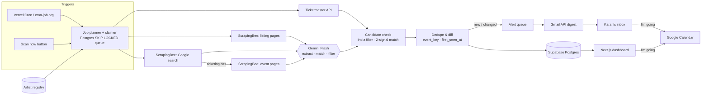

# Early Bird

**Concert alerts for the artists you follow — India-wide, Bengaluru first, early-bird windows flagged the minute they open.**

Karan follows ~60 artists, mostly mid-tier acts that never trend. Their India dates get announced quietly on BookMyShow, District, Skillbox or an Instagram post, and the early-bird tier is gone in a day. Early Bird watches every source on a schedule, turns messy pages into clean show records with Gemini Flash, de-duplicates them, and emails him the moment something new appears. One tap on “I'm going” books it into Google Calendar with a reminder before the early bird closes.

| | |
|---|---|
| **Live app** | `https://<your-project>.vercel.app` |
| **Stack** | Next.js 15 (App Router) · Supabase Postgres · Gemini Flash · ScrapingBee · Ticketmaster Discovery · Gmail API · Google Calendar API · Deezer · Vercel Cron |
| **Components map** | `docs/components-map.html` (also published as an artifact) |

---

## What it does

1. **Watchlist** — 60 seeded artists (Indian indie + international touring acts). Add more by typing (autocomplete with photos from Deezer, no key needed), pasting a list, or uploading a CSV. Star favourites to check them on every scan. Spotify import is deliberately *optional*: nothing blocks on OAuth.
2. **Live sources, every run**
   - **City listing pages** (District, BookMyShow, AllEvents) rendered through **ScrapingBee** with Indian proxies. Bengaluru pages run every scan; other metros rotate.
   - **Ticketmaster Discovery API** per artist (India, music only) — deterministic mapping, presale windows read as early-bird.
   - **Google search through ScrapingBee** per artist — snippets go to Gemini first (cheap), and only ticketing-site hits get a full page fetch.
   - Optional **Bandsintown**.
3. **Gemini Flash as the extraction brain** — JSON-mode with a strict schema: artist, venue, city, date, time, ticket URL, `early_bird_status` (available / upcoming / sold_out / none / unknown), deadline, price, scarcity phrases, tribute-act flag, confidence and a verbatim evidence quote. It also matches fuzzy names against the watchlist and drops non-India shows. Output is Zod-validated; a bad answer gets one repair retry.
4. **Two-signal artist matching** — Gemini's match and a deterministic matcher (alias table, tour-noise stripping, Jaro-Winkler) must agree, or the show is held as *Unconfirmed* until a second source corroborates it. Short names like “Dot.” never match on text alone.
5. **Dedupe and diff** — every show is keyed `artist|city|date`, so the same Bengaluru date from three sites is one row with three sources. `first_seen_at` is set once and never overwritten — that is the proof an alert fired at announcement. Reschedules (same ticket link, new date) move the row instead of creating a duplicate.
6. **Alerts that fire only when it matters** — new show; early bird flips to open (urgent); deadline inside 24h (urgent); venue/date change (quiet). Each scan sends **one digest email via the Gmail API**, Bengaluru first, urgent flags in bold, with *Get tickets*, *I'm going*, *Remind me* and *Add to Google Calendar* buttons. Alerts are unique on a dedupe key, so retries never double-send.
7. **Decide → calendar** — *I'm going* creates the show in Google Calendar plus an “early bird ends” event 30 minutes before the deadline; *Remind me* creates only the reminder. Event IDs are hashed so pressing twice never duplicates. Without a Google connection the same button opens a prefilled Google Calendar page — nothing breaks.
8. **Dashboard** — Bengaluru pinned, early-bird badges with live countdowns, city and early-bird filters, a provenance timeline per show, alert history, and a **Live data** page listing every scan, every source hit, results and ScrapingBee credits used.

## Architecture



**Why a job queue?** Vercel functions time out (60 s on Hobby). A scan is planned into `scan_jobs`; each `/api/scan/step` call claims jobs atomically (`claim_jobs` uses `FOR UPDATE SKIP LOCKED`) and works until its time budget runs out. The browser loops steps and shows live progress; cron calls resume an unfinished run. Two clicks never start two scans (`one_running_scan` partial unique index), and a crashed run is closed automatically after 10 minutes without a heartbeat.

**Cost control.** ScrapingBee credits are capped per day (Settings). Pages are hashed; an unchanged page skips Gemini entirely. Detail pages are refetched at most every 6 hours. Escalation from plain JS rendering to premium proxies happens only when a site blocks.

## Data model

| Table | Purpose |
|---|---|
| `artists` | watchlist, aliases, tier, photo, last checked |
| `events` | one row per show (`event_key` unique), early-bird state, decision, calendar links, `first_seen_at` |
| `event_sources` | every URL a show was seen on, with first/last seen times |
| `event_changes` | field-level history (venue, early-bird status, deadline, date) |
| `alerts` | queued/sent alerts, unique `dedupe_key`, delivery channel and Gmail message id |
| `scan_runs`, `scan_jobs` | run log and work queue — powers the Live data page |
| `source_health`, `fetched_pages` | per-source health and credits today; page content hashes |
| `settings` | alert email, credit cap, encrypted Google refresh token |

All tables have RLS on. The server uses either the service-role key or the publishable key **plus** an `x-app-secret` header that the policies check against `private.app_config` — the browser never holds a database key.

## Setup (≈10 minutes)

1. **Supabase** — create a project, then run `supabase/migrations/0001_init.sql` and `supabase/seed.sql` in the SQL editor.
   If you use the publishable key instead of service-role, also run:
   `insert into private.app_config (id, secret) values (1, '<random string>');` and set the same value as `SUPABASE_APP_SECRET`.
2. **Deploy** — import the repo in Vercel, add environment variables from `.env.example`, deploy. Only the Supabase variables are needed to see the dashboard; every other integration switches on when its key appears.
3. **Gemini** — key from <https://aistudio.google.com/apikey> → `GEMINI_API_KEY`.
4. **ScrapingBee** — key from the ScrapingBee dashboard → `SCRAPINGBEE_API_KEY`. Set a daily credit cap in Settings that suits your plan.
5. **Ticketmaster** (optional) — free key at <https://developer.ticketmaster.com> → `TICKETMASTER_API_KEY`.
6. **Gmail + Calendar** — in Google Cloud Console: enable *Gmail API* and *Google Calendar API*; configure the OAuth consent screen (External, add your address as a test user); create an OAuth client (*Web application*) with redirect URI `https://<your-app>/api/google/callback` (and `http://localhost:3000/api/google/callback` for local). Set `GOOGLE_CLIENT_ID`, `GOOGLE_CLIENT_SECRET`, `TOKEN_ENCRYPTION_KEY` (`openssl rand -base64 32`). Then press **Connect Google** in Settings.
   No OAuth? Set `GMAIL_SMTP_USER` + `GMAIL_APP_PASSWORD` and email still works; calendar falls back to prefilled links.
7. **Schedule** — Vercel Hobby allows one cron per day (configured in `vercel.json`, 08:00 IST). For 30-minute checks, create a free job at cron-job.org hitting `https://<your-app>/api/cron/scan?key=<CRON_SECRET>`.

### Local development

```bash
cp .env.example .env.local   # fill in what you have
npm install
npm run dev                  # http://localhost:3000
npm test                     # 25 unit tests: matching, merge rules, candidate filters
```

## Testing the whole loop

1. Open the app → seeded shows appear, Bengaluru pinned.
2. Settings → **Test Gemini**, **Test ScrapingBee**, **Send test email**.
3. Press **Scan now** → watch each source tick through; new shows land on the feed.
4. Check your inbox for the digest → tap **I'm going** → confirm → the event is in Google Calendar.
5. **Live data** shows every request, result and credit.

## Environment variables

See `.env.example`. Nothing secret is committed; `.env*` is git-ignored.

## Decisions worth knowing

- **City, not venue, in the dedupe key.** Venue names are spelled differently on every site (“Phoenix Marketcity” vs “Phoenix Mall of Asia”); an artist essentially never plays two venues in one city on one day.
- **Mail scanners pre-open links**, so email buttons land on a confirm page that needs one tap. A GET never changes data.
- **A weaker source can't close an open early-bird window** — only an equal or stronger ticketing source can.
- **Seeded shows are real** public announcements, each linked to the article it came from, and recorded under a `seed` scan so provenance is honest.
